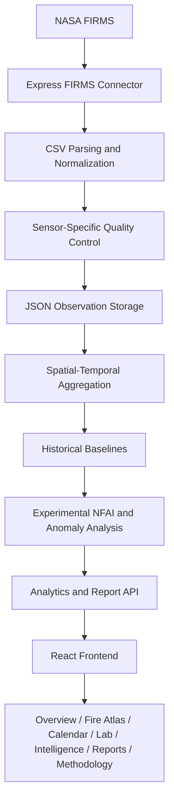

# FIREWEAVE

### Understanding Two Decades of Earth's Burning Patterns

**FIREWEAVE** is a sensor-aware satellite fire-activity intelligence platform developed for **NASA Space Apps Challenge 2026 — Challenge #9: Harmonization of MODIS and VIIRS Hot Spots**. It uses active-fire observations distributed through NASA's Fire Information for Resource Management System (FIRMS) and provides tools for geospatial exploration, sensor-aware data processing, temporal aggregation, experimental normalization, and scientific reporting.

<p align="left">
  <a href="https://fireweave.pages.dev/"><strong>Open the live application</strong></a> ·
  <a href="https://github.com/Khoberpn/FIREWEAVE"><strong>Source repository</strong></a> ·
  <a href="https://www.spaceappschallenge.org/2026/challenges/harmonization-of-modis-and-viirs-hot-spots/"><strong>NASA Challenge #9</strong></a>
</p>

> **Scientific scope note:** FIREWEAVE is an analytical and visualization application, not an official NASA product. A hotspot is a satellite-detected thermal anomaly pixel; it is not automatically a unique fire, a fire perimeter, or a measurement of burned area. MODIS and VIIRS raw detection counts must not be treated as directly interchangeable.

---

## Table of Contents

- [1. Project Overview](#1-project-overview)
- [2. The Problem](#2-the-problem)
- [3. Project Objectives](#3-project-objectives)
- [4. Core Features](#4-core-features)
- [5. Data Sources and Satellite Coverage](#5-data-sources-and-satellite-coverage)
- [6. Scientific Workflow](#6-scientific-workflow)
- [7. Methodology and Derived Indicators](#7-methodology-and-derived-indicators)
- [8. Current Data Coverage and Limitations](#8-current-data-coverage-and-limitations)
- [9. FIA — FIREWEAVE Intelligent Assistant](#9-fia--fireweave-intelligent-assistant)
- [10. System Architecture](#10-system-architecture)
- [11. Technology Stack](#11-technology-stack)
- [12. Repository Structure](#12-repository-structure)
- [13. Getting Started](#13-getting-started)
- [14. Environment Configuration](#14-environment-configuration)
- [15. Available API Routes](#15-available-api-routes)
- [16. Build and Testing](#16-build-and-testing)
- [17. Deployment](#17-deployment)
- [18. Security and Responsible Use](#18-security-and-responsible-use)
- [19. Known Limitations and Roadmap](#19-known-limitations-and-roadmap)
- [20. Data Attribution and References](#20-data-attribution-and-references)
- [21. AI-Assisted Development Disclosure](#21-ai-assisted-development-disclosure)
- [22. Team and Acknowledgements](#22-team-and-acknowledgements)
- [23. License](#23-license)

---

## 1. Project Overview

Satellite instruments have recorded active-fire observations across the Earth for decades. These observations are valuable for examining where thermal anomalies are detected and how observed activity varies over time. However, long-term comparisons become difficult when observations from different instruments are combined without accounting for their different characteristics.

FIREWEAVE addresses this challenge by preserving sensor identity and processing information throughout its data workflow. It supports observations from:

- **MODIS:** Terra and Aqua.
- **VIIRS:** Suomi-NPP, NOAA-20, and NOAA-21.

The application retrieves NASA FIRMS data through a server-side connector, converts source records into a common internal observation schema, applies validation and quality-control checks, and exposes observation and analytical endpoints to a React application.

The initial demonstration geography is **Indonesia**, with **Central Kalimantan** as a region of particular interest. The codebase includes geographic bounds and a Central Kalimantan boundary asset. The available data snapshot described in the evidence audit was retrieved for a wider Indonesia bounding box; a dedicated multi-year Central Kalimantan archive has not been established in that audit.

### Project identity

| Item | Description |
|---|---|
| Project | FIREWEAVE |
| Tagline | Understanding Two Decades of Earth's Burning Patterns. |
| Category | Sensor-Aware Fire Activity Intelligence Platform |
| Event | NASA Space Apps Challenge 2026 |
| Selected challenge | Challenge #9 — Harmonization of MODIS and VIIRS Hot Spots |
| Primary data provider | NASA FIRMS |
| Demonstration geography | Indonesia; Central Kalimantan is the focused regional context |
| Live application | https://fireweave.pages.dev/ |

The phrase “Two Decades” refers to the broader historical satellite-observation context and the intended analytical direction. It does **not** mean that the current repository snapshot contains two decades of processed observations.

---

## 2. The Problem

MODIS and VIIRS both provide active-fire observations, but their records are not identical measurements. They differ in spatial resolution, detection behavior, instrument characteristics, observation geometry, acquisition timing, and confidence conventions.

Consequently, simply adding MODIS and VIIRS detections together can create misleading comparisons. A difference in raw counts can reflect sensor and observation differences as well as changes in the observed environment.

A meaningful analytical workflow therefore needs to:

1. Preserve the original sensor and product identity.
2. Interpret each sensor's metadata in its own context.
3. Apply explicit quality-control rules.
4. Aggregate observations into documented spatial and temporal units.
5. Build separate reference baselines for each sensor and source product.
6. Display data coverage, uncertainty, and limitations alongside derived indicators.

FIREWEAVE is designed around these principles. It is intended to help users inspect satellite observations and investigate historical patterns without presenting raw hotspot counts as calibrated fire counts or burned-area estimates.

---

## 3. Project Objectives

- Integrate NASA FIRMS active-fire observations into a web-based geospatial application.
- Support MODIS Terra/Aqua and VIIRS Suomi-NPP, NOAA-20, and NOAA-21 products.
- Preserve native observation metadata and distinguish Standard Processing (SP) from Near Real-Time (NRT) products.
- Validate incoming records and retain information about rejected records.
- Aggregate observations spatially and temporally while retaining sensor identity.
- Provide an experimental, transparent framework for sensor-specific historical comparison.
- Make observation provenance and methodological limitations visible to users.
- Provide regional summaries and exportable reports for further inspection.

---

## 4. Core Features

FIREWEAVE is organized around seven primary scientific sections, with additional tools kept separate from the main navigation.

### 4.1 Overview

A centralized entry point for the application's observation and monitoring context. It brings together satellite feed status, observation summaries, sensor coverage, regional context, and navigation to the analytical sections.

**Purpose:** help users understand which observations and sensors are represented before exploring individual records or derived analysis.

### 4.2 Fire Atlas

An interactive geospatial interface for exploring satellite-observed active-fire detections. The application supports separate sensor/product selections and map-based inspection of observation locations.

**Intended use:** explore the spatial distribution of detections, inspect observation metadata, and distinguish MODIS observations from VIIRS observations.

**Scientific caution:** a map point represents an observation record, not necessarily a unique fire event or the complete perimeter of a fire.

### 4.3 Burning Activity Calendar

A temporal view that organizes observed detections by year, month, and spatial aggregation cells. The backend exposes raw observation output and a separate harmonized view that uses the experimental FIREWEAVE NFAI calculation.

**Purpose:** help users inspect when detections occur and compare periods without silently merging sensor identities or processing types.

**Important:** a meaningful multi-year seasonal calendar requires sufficient historical data. The currently documented data inventory is too short to support a validated multi-year seasonal interpretation.

### 4.4 Harmonization Lab

A workspace for examining sensor-specific records and the processing concepts used by FIREWEAVE. The backend includes spatial-temporal aggregation, per-sensor baseline calculation, NFAI computation, anomaly detection, and a ratio-based sensor comparison routine.

**Purpose:** make the processing workflow inspectable and explain why raw MODIS and VIIRS counts should not be treated as equivalent measurements.

### 4.5 Fire Season Intelligence

A regional seasonal-analysis experience built around the **Fire Season Fingerprint** concept. The backend can organize monthly activity by year and produce a monthly climatology summary from the observations available to it.

**Purpose:** provide a framework for examining recurring seasonal patterns and unusual periods when sufficiently long, quality-controlled historical records are available.

**Current limitation:** the documented repository data snapshot contains only a short NRT period. It cannot establish a scientifically defensible multi-year seasonal fingerprint.

### 4.6 Regional Reports

A reporting endpoint that can return JSON, CSV, and PDF output for a selected region and observation period. Reports include observation counts by sensor, source metadata, grid summaries, analytical fields, source attribution, and limitations.

**Purpose:** provide structured outputs that can be inspected, shared, and independently reviewed.

### 4.7 Data & Methodology

A documentation area explaining NASA FIRMS data, processing distinctions, the derived NFAI indicator, sensor characteristics, and scientific caveats.

**Purpose:** make the boundary between original NASA observations and FIREWEAVE-derived calculations clear.

### Secondary tools

The repository also contains secondary navigation for data-ingestion and scenario/archive-related views. These should be treated according to their actual implementation and data provenance; their presence in the interface does not imply that every associated workflow is connected to a validated external dataset.

---

## 5. Data Sources and Satellite Coverage

### 5.1 Primary source: NASA FIRMS

FIREWEAVE uses NASA's **Fire Information for Resource Management System (FIRMS)** as its primary active-fire data source.

- Main portal: https://firms.modaps.eosdis.nasa.gov/
- API documentation: https://firms.modaps.eosdis.nasa.gov/api/
- Area API documentation: https://firms.modaps.eosdis.nasa.gov/api/area/
- Data availability API: https://firms.modaps.eosdis.nasa.gov/api/data_availability/

The backend connector keeps `FIRMS_MAP_KEY` on the server. It supports request throttling, in-flight request de-duplication, caching, retry logic, and credential scrubbing in error handling.

### 5.2 Supported source identifiers

The application data model recognizes eight source identifiers:

| Instrument | Satellite | Standard Processing | Near Real-Time |
|---|---|---|---|
| MODIS | Terra / Aqua | `MODIS_SP` | `MODIS_NRT` |
| VIIRS | Suomi-NPP | `VIIRS_SNPP_SP` | `VIIRS_SNPP_NRT` |
| VIIRS | NOAA-20 | `VIIRS_NOAA20_SP` | `VIIRS_NOAA20_NRT` |
| VIIRS | NOAA-21 | `VIIRS_NOAA21_SP` | `VIIRS_NOAA21_NRT` |

The presence of a source identifier in the code means the application can recognize and process that product type. It does not, by itself, prove that records for that product have been imported or validated in the current data store.

### 5.3 Standard Processing and Near Real-Time

FIREWEAVE distinguishes two processing categories:

- **Standard Processing (SP):** represented separately in the data model for historical analysis when an appropriate archive has been retrieved and quality-checked.
- **Near Real-Time (NRT):** used for recent observation monitoring. NRT data can be provisional and should not be silently mixed with SP records in a historical baseline.

Every analysis should report the product/source and processing type used.

### 5.4 Observation attributes

The canonical observation model preserves or represents fields such as:

- Source dataset identifier.
- Satellite and instrument.
- Processing type and processing version, where available.
- Latitude and longitude.
- Acquisition date and native acquisition time.
- Native confidence value and optional numeric confidence representation.
- Fire Radiative Power (FRP), where available.
- Brightness, scan, and track attributes, where available.
- Day/night flag.
- Original source record (`rawRecord`).
- Import timestamp, optional batch identifier, and region code.

Missing attributes must remain distinguishable from measured zero values.

---

## 6. Scientific Workflow

The implementation is organized into the following processing stages.

### Stage 1 — Data acquisition

The server-side FIRMS connector constructs NASA FIRMS requests for supported data sources and geographic bounds. API credentials remain on the server and are not intended to be exposed to the browser.

### Stage 2 — Parsing and normalization

NASA CSV rows are parsed and mapped into a canonical `FireObservation` structure. The ingestion layer identifies supported satellite/instrument combinations and processing categories.

### Stage 3 — Sensor-aware quality control

The ingestion pipeline checks required fields and valid coordinate/date ranges. It records rejected rows with row indices and rejection reasons rather than silently treating invalid records as valid observations.

### Stage 4 — Deduplication and storage

The JSON storage layer de-duplicates observations using a composite signature based on source dataset, satellite, acquisition date/time, and rounded coordinates. This is intended to reduce duplicate records caused by overlapping retrieval windows.

### Stage 5 — Spatial-temporal aggregation

The harmonization service assigns observations to **0.1° latitude/longitude bins** and retains time labels including year, month, and ISO week. MODIS and VIIRS counts and their source identifiers remain separate within aggregated cells.

### Stage 6 — Sensor-specific baseline calculation

The baseline routine calculates monthly reference statistics by sensor and source product. The implementation includes median, median absolute deviation (MAD), percentiles, mean, and year coverage. A baseline is marked sufficient only when at least three distinct years are represented.

### Stage 7 — Derived activity and anomaly analysis

The backend calculates the experimental NFAI indicator and robust-score anomaly categories. Results must be interpreted together with baseline sufficiency and coverage information.

### Stage 8 — Comparison and reporting

Sensor-comparison outputs and regional reports summarize the stored observations and derived results. Reports include scientific limitations and NASA FIRMS attribution.

---

## 7. Methodology and Derived Indicators

> The methods in this section are implemented as FIREWEAVE-derived calculations. They are not official NASA products, and their scientific usefulness depends on data coverage, appropriate product selection, and further validation.

### 7.1 Spatial aggregation

The harmonization service uses a nominal grid resolution of:

\[
\Delta_{lat} = \Delta_{lon} = 0.1^\circ
\]

Coordinates are assigned to bins using floor-based latitude and longitude binning. Aggregated cells retain separate MODIS and VIIRS counters, product identifiers, and temporal labels.

A degree of longitude does not represent a constant ground distance at every latitude. The 0.1° grid is an aggregation convention, not an equal-area grid.

### 7.2 Historical baseline

For each sensor/source product and calendar month, the implementation calculates statistics across the available years, including:

- Median detection count.
- Median Absolute Deviation (MAD).
- 10th, 50th, and 90th percentiles.
- Mean and standard deviation.
- Number of years represented.

The baseline routine requires at least **three distinct years** before setting the baseline as sufficient. This is a minimum implementation threshold, not a guarantee that three years are scientifically adequate for every region or purpose.

### 7.3 Normalized Fire Activity Index (NFAI)

NFAI is an experimental metric defined by FIREWEAVE. It is not an official NASA index.

The current implementation computes:

\[
RZ = \frac{O - M}{1.4826 \times MAD + 1}
\]

\[
NFAI = \operatorname{clamp}\left(\frac{RZ}{3}, -1, 1\right)
\]

Where:

- \(O\) = observed detection count for the selected sensor, source, and month.
- \(M\) = historical monthly median for that sensor/source baseline.
- \(MAD\) = median absolute deviation of the historical monthly counts.
- \(RZ\) = robust deviation score used by the implementation.
- `clamp` limits the output to the interval \([-1, 1]\).

The implementation also assigns a directional label (`increase`, `decrease`, or `stable`), a seasonal context, a coverage value, and an uncertainty label based on the number of years represented.

**Interpretation warning:** NFAI is a relative, sensor/source-specific experimental indicator. It is not burned area, fire intensity, a unique-fire count, or a calibrated cross-sensor conversion. It should not be interpreted as a validated historical anomaly while the baseline is insufficient.

### 7.4 Anomaly categories

The current anomaly routine uses absolute robust-score thresholds:

| Absolute robust score | Implementation category |
|---:|---|
| < 1.5 | None |
| ≥ 1.5 | Minor |
| ≥ 2.5 | Moderate |
| ≥ 3.5 | Severe |

These are rule-based categories in the current implementation. They are not p-values and do not establish statistical significance or causation.

### 7.5 Cross-sensor comparison

The current comparison routine uses a ratio-based heuristic. Its “consistent” category is based on a detection-count ratio no greater than 2:1, while larger divergence is categorized as divergent; insufficient observations are treated separately.

This is a screening heuristic, not a formal sensor calibration, equivalence test, or validation that the instruments measure identical quantities. Sensor characteristics, coverage, overpass timing, confidence definitions, and sampling differences remain relevant.

---

## 8. Current Data Coverage and Limitations

The repository includes `FIREWEAVE_EVIDENCE_AUDIT.md`, which records a data inventory snapshot dated **15 November 2026**. The figures below describe that audit snapshot, not a live count and not necessarily the current production database.

### 8.1 Server observation snapshot recorded in the audit

| Dataset | Records in the audit snapshot |
|---|---:|
| `MODIS_NRT` | 708 |
| `VIIRS_NOAA20_NRT` | 5,013 |
| `VIIRS_NOAA21_NRT` | 3,823 |
| `VIIRS_SNPP_NRT` | 741 |
| **Total** | **10,285** |

- Recorded period: **2–14 November 2026**.
- Processing represented: **NRT only**.
- Geographic retrieval: a wider Indonesia bounding box.
- The audit did not find imported Standard Processing historical records.

The same audit recorded a separate client-side snapshot of 4,961 VIIRS NOAA-20 NRT observations from 10–14 November 2026. Client-side and server-side inventories are separate snapshots and should not be added together as if they were one deduplicated dataset.

### 8.2 Consequences for interpretation

The audit snapshot does not provide multi-year historical coverage. Therefore:

- A validated multi-year seasonal baseline cannot be claimed from that snapshot.
- The NFAI formula is implemented and unit-tested, but its historical interpretation requires adequate real multi-year records.
- A Fire Season Fingerprint based on one short NRT window cannot establish recurring seasonal behavior.
- Cross-sensor comparisons are limited to the short, available observation period and are not evidence of long-term equivalence.
- Central Kalimantan is the intended demonstration region, but the audit describes the available records as retrieved over a wider Indonesia bounding box; a separately validated long-term Central Kalimantan archive is not established there.

Before publishing new numerical claims, rerun the data inventory against the current production dataset and record the date range, source products, processing type, geographic filter, retrieval timestamp, and record counts.

### 8.3 Known illustrative or unverified dashboard values

The evidence audit identified some static or hardcoded interface values relating to sensor-health counts, model precision, rainfall, soil moisture, El Niño conditions, false-positive totals, and risk-zone counts. These values must not be presented as verified live measurements unless their data sources and calculation paths have since been replaced and independently checked.

The Fire Atlas also contains fallback/demo visualization logic. If a fallback is shown, it must be clearly identified as illustrative and must not be represented as a current NASA observation.

---

## 9. FIA — FIREWEAVE Intelligent Assistant

**FIA** is a domain-specific scientific interpretation assistant integrated into the FIREWEAVE interface. It is designed to help users understand satellite fire observations and remote-sensing concepts, including:

- MODIS and VIIRS sensor differences.
- Active-fire observations and Fire Radiative Power (FRP).
- Spatial-temporal aggregation.
- Historical baselines and MAD-based robust statistics.
- The experimental NFAI formulation.
- Data limitations and scientific references.

### How FIA currently works

In the inspected source code, FIA uses a local domain-intelligence engine with topic-based routing and predefined analytical explanations. It reads stored observations to calculate summary quantities such as MODIS/VIIRS record totals and FRP summaries, and it returns contextual explanations and references.

**FIA should not be described as a trained machine-learning model, a general-purpose LLM, an autonomous forecasting system, or a fire-cause detection system.** The inspected implementation does not establish those capabilities. Some climate-related demonstration values in the FIA service are static and must not be treated as live climate observations.

Conversation state is held in an in-memory map in the current route implementation. It is therefore not a durable conversation history store and may be lost when the service restarts.

---

## 10. System Architecture



### Runtime components

- **Frontend:** React + TypeScript + Vite single-page application.
- **Backend:** Node.js + Express + TypeScript API.
- **Scientific services:** ingestion, quality control, storage, harmonization, analytics, reporting, and FIA domain logic.
- **Storage:** JSON files under the backend working directory's `data/` folder in the current implementation.
- **External data:** NASA FIRMS.

---

## 11. Technology Stack

### Frontend

| Technology | Role |
|---|---|
| React 19 | Component-based user interface |
| TypeScript | Static typing |
| Vite 7 | Development server and production bundler |
| MapLibre GL JS | WebGL map rendering |
| react-map-gl | React bindings for map components |
| Recharts | Charts and data visualization |
| Lucide React | Interface icons |

### Backend

| Technology | Role |
|---|---|
| Node.js | JavaScript runtime |
| Express 4 | HTTP API framework |
| TypeScript | Backend implementation and domain types |
| Zod | Request/data validation |
| Helmet | HTTP security headers |
| CORS middleware | Cross-origin request handling |
| Morgan | HTTP request logging |
| dotenv | Local environment variable loading |
| pdf-lib | PDF report generation |

### Testing and tooling

- Vitest for backend unit tests.
- TypeScript compiler (`tsc`) for type checking and compilation.
- npm for dependency installation and scripts.
- GitHub for source control.
- Railway for backend hosting.
- Cloudflare Pages for frontend hosting.

---

## 12. Repository Structure

```text
FIREWEAVE/
├── client/
│   ├── public/
│   │   ├── central-kalimantan.geojson
│   │   └── fireweave-mark.svg
│   ├── src/
│   │   ├── components/
│   │   │   ├── atlas/
│   │   │   ├── calendar/
│   │   │   ├── harmonization/
│   │   │   ├── intelligence/
│   │   │   ├── methodology/
│   │   │   ├── overview/
│   │   │   └── reports/
│   │   ├── App.tsx
│   │   ├── api.ts
│   │   ├── hooks.ts
│   │   ├── main.tsx
│   │   ├── styles.css
│   │   └── utils.ts
│   ├── package.json
│   ├── package-lock.json
│   ├── tsconfig.json
│   └── vite.config.ts
├── server/
│   ├── data/
│   │   ├── observations.json
│   │   └── cache.json
│   ├── src/
│   │   ├── routes/
│   │   ├── services/
│   │   ├── index.ts
│   │   ├── middleware.ts
│   │   └── types.ts
│   ├── tests/
│   │   └── processing.test.ts
│   ├── .env.example
│   ├── package.json
│   ├── package-lock.json
│   └── tsconfig.json
├── FIREWEAVE_EVIDENCE_AUDIT.md
├── FIREWEAVE_NASA_COMPLIANCE_CHECKLIST.md
├── .env.example
├── .gitignore
├── package.json
└── package-lock.json
```

The repository may evolve. Use the current GitHub tree as the authoritative file inventory.

---

## 13. Getting Started

### Prerequisites

- Node.js and npm.
- Git.
- A NASA FIRMS MAP_KEY for live FIRMS requests.
- A terminal such as PowerShell, Windows Terminal, or a Unix shell.

### 13.1 Clone the repository

```bash
git clone https://github.com/Khoberpn/FIREWEAVE.git
cd FIREWEAVE
```

### 13.2 Install dependencies

The frontend and backend have separate package manifests and lockfiles.

```bash
npm ci --prefix server
npm ci --prefix client
```

### 13.3 Configure the backend environment

On Windows PowerShell:

```powershell
Copy-Item .\server\.env.example .\server\.env
```

Open `server/.env` and provide your own NASA FIRMS key:

```env
FIRMS_MAP_KEY=YOUR_NASA_FIRMS_MAP_KEY
PORT=3001
```

Do not commit `server/.env`. Do not put `FIRMS_MAP_KEY` in a `VITE_` variable or any frontend file.

### 13.4 Start the backend

From the repository root:

```bash
npm run dev:server
```

The backend development script uses `tsx watch` and defaults to port `3001` when `PORT` is not set.

Health endpoint:

```text
http://localhost:3001/api/_health
```

### 13.5 Start the frontend

Open a second terminal at the repository root:

```bash
npm run dev:client
```

Vite runs on:

```text
http://localhost:5173
```

The current Vite configuration proxies local `/api` requests to `http://localhost:3001` during development.

---

## 14. Environment Configuration

| Variable | Used by | Purpose |
|---|---|---|
| `FIRMS_MAP_KEY` | Backend only | Authenticates server-side NASA FIRMS requests |
| `PORT` | Backend | Port on which Express listens; hosting platforms commonly provide this automatically |
| `NODE_ENV` | Backend/deployment | Runtime environment indicator, if used by deployment configuration |

The backend must receive `FIRMS_MAP_KEY` as a server-side environment secret in Railway or another backend host. Never expose the value in the frontend bundle, public repository, logs, screenshots, or issue reports.

### Production API routing note

The current `client/src/api.ts` uses relative `/api/...` request paths. The proxy in `client/vite.config.ts` is a **development-only Vite proxy** to `localhost:3001`; it is not automatically available on a static Cloudflare Pages deployment.

For a separate Cloudflare Pages frontend and Railway backend, production traffic to `/api` must be routed to the backend through a configured reverse proxy, Cloudflare Worker/Pages Function, or an explicitly implemented frontend API base URL. Confirm the deployed routing configuration before changing or documenting a `VITE_API_BASE_URL` value: adding an environment variable alone does not change the current API client unless the code reads it.

---

## 15. Available API Routes

The following route groups are mounted by the current Express application.

### Health and system

| Method | Path | Description |
|---|---|---|
| GET | `/api/_health` | Basic backend health check |
| GET | `/api/system/data-status` | Stored observation summary and NASA connector health information |

### NASA FIRMS

| Method | Path | Description |
|---|---|---|
| GET | `/api/nasa/firms/health` | Checks NASA FIRMS connectivity |
| GET | `/api/nasa/firms/availability` | Retrieves FIRMS data-availability output |
| GET | `/api/nasa/firms/observations` | Retrieves observations for a selected source, date window, and bounding box |

The observations endpoint accepts bounding-box coordinates (`west`, `south`, `east`, `north`), a supported `source`, optional `date`, `dayRange` (limited in the route to 1–5 days), and optional `region`.

### Analytics

| Method | Path | Description |
|---|---|---|
| GET | `/api/analytics/activity-calendar` | Returns spatial-temporal activity cells and optional harmonized output |
| GET | `/api/analytics/seasonal-fingerprint` | Returns year/month fingerprint records and monthly climatology from stored observations |
| GET | `/api/analytics/sensor-comparison` | Returns month-level MODIS/VIIRS comparison output |
| GET | `/api/analytics/anomalies` | Returns anomaly categories for a sensor/source and date window |
| POST | `/api/analytics/harmonize` | Returns grid, baseline, and NFAI calculation output for a requested period and region |

### Reports and import

| Method | Path | Description |
|---|---|---|
| GET | `/api/reports/regional` | Returns a regional report as JSON, CSV, or PDF using `format=json`, `format=csv`, or `format=pdf` |
| POST | `/api/import/nasa-csv` | Parses and imports a NASA-format CSV payload |

**Security warning:** in the inspected source, the CSV import route is mounted without authentication. Do not treat it as a protected operator endpoint. Disable it or add proper authentication, authorization, input limits, and rate controls before allowing unrestricted public use.

### FIA assistant

The FIA router is mounted under both `/api/fia` and `/api/ai`. Its current route set includes health, suggestions, wind/context output, and chat endpoints. Climate-related values returned by the current implementation include static demonstration values and must not be represented as live meteorological data.

---

## 16. Build and Testing

### Build the backend

```bash
npm run --prefix server build
```

### Run backend tests

```bash
npm run --prefix server test
```

The Vitest suite covers core processing behavior including:

- NASA CSV parsing.
- Observation normalization and source identification.
- Required-field and coordinate validation.
- Spatial-temporal grid aggregation.
- Historical baseline sufficiency.
- NFAI calculation and bounds.
- Anomaly classification.
- Sensor-comparison logic.
- Date-range chunking for FIRMS requests.

### Build the frontend

```bash
npm run --prefix client build
```

### Build both applications

```bash
npm run build
```

A successful local build is not a substitute for testing live NASA connectivity, production API routing, persistent storage, or the scientific validity of results produced from a particular dataset.

---

## 17. Deployment

FIREWEAVE's demonstrated hosting arrangement is:

- **Frontend:** Cloudflare Pages — https://fireweave.pages.dev/
- **Backend:** Railway — use the public service domain configured in the Railway project.
- **Source code:** GitHub — https://github.com/Khoberpn/FIREWEAVE

### 17.1 Cloudflare Pages

Typical project configuration for the current repository layout:

| Setting | Value |
|---|---|
| Repository | `Khoberpn/FIREWEAVE` |
| Production branch | `main` |
| Root directory | `client` |
| Build command | `npm run build` |
| Build output directory | `dist` |

### 17.2 Railway backend

Typical service configuration for the current backend package:

| Setting | Value |
|---|---|
| Repository | `Khoberpn/FIREWEAVE` |
| Root directory | `/server` |
| Build command | `npm ci --include=dev && npm run build` |
| Start command | `npm start` |
| Required secret | `FIRMS_MAP_KEY` |

The backend storage service currently resolves its JSON data directory as `path.join(process.cwd(), 'data')`. With `/server` used as the service root directory, verify that the runtime working directory contains the intended `data/observations.json` file.

### 17.3 Persistent storage

The current storage layer writes JSON files to the local filesystem. A platform's ephemeral filesystem may be cleared during restarts, redeployments, or instance replacement. If observations or import records must survive those events, configure a persistent volume mounted at the exact path used by the storage service, or migrate the storage layer to a managed database/object store.

The current `storage.ts` implementation does not read a `DATA_DIR` environment variable. Do not assume that setting `DATA_DIR` alone changes its storage path. Update and test the storage implementation before relying on a volume mounted at a different directory.

### 17.4 Production verification checklist

- [ ] Backend health endpoint returns HTTP 200.
- [ ] NASA FIRMS health endpoint is checked independently of the application health endpoint.
- [ ] `FIRMS_MAP_KEY` exists only in backend secrets.
- [ ] Frontend `/api` requests are routed to the deployed backend.
- [ ] CORS is restricted to the intended frontend origin(s).
- [ ] Public ingestion/write endpoints have appropriate access controls.
- [ ] Seed observations are readable after deployment.
- [ ] Persistent storage behavior is tested across a redeployment.
- [ ] Empty, unavailable, cached, and incomplete-data states are clearly distinguished.

---

## 18. Security and Responsible Use

FIREWEAVE processes public satellite observations, but its backend still requires appropriate operational safeguards.

### Credential handling

- Keep `FIRMS_MAP_KEY` server-side.
- Store production secrets in the hosting provider's secret/environment-variable manager.
- Never commit `.env` files or real credentials.
- Do not include credential-bearing NASA request URLs in logs, error messages, screenshots, or reports.
- Rotate a key if it has been exposed.

### API protection

Before unrestricted public operation, review and implement:

- An explicit CORS origin allowlist.
- Rate limiting for endpoints that call NASA FIRMS.
- Authentication and authorization for import or other write operations.
- Request-size and parameter limits.
- Geographic and date-range validation.
- Safe error responses and credential redaction.
- Abuse controls for endpoints that trigger upstream API calls or persistent writes.

CORS is a browser policy, not an authentication system. It does not prevent direct HTTP clients from calling an API.

### Scientific responsibility

FIREWEAVE must not be used to:

- Identify people responsible for a fire.
- Prove the cause or intent behind an observed hotspot.
- Treat every detection as a unique fire.
- Infer burned area or fire perimeter from hotspot points alone.
- Claim validated future-fire prediction.
- Claim statistical significance without an appropriate statistical test.
- Interpret missing satellite observations as proof that no fire occurred.

---

## 19. Known Limitations and Roadmap

The repository's evidence audit identifies the following limitations as of its audit date. Re-check the current code and data before relying on this list as a live status report.

### Current limitations

- The audited observation inventory contained NRT records only and covered approximately 12 days in November 2026.
- No multi-year Standard Processing archive was present in that snapshot.
- The historical baseline code requires at least three distinct years; the audited data did not meet this condition.
- NFAI's mathematical implementation was covered by unit tests using synthetic test cases, but the audit did not establish validation against a suitable multi-year real historical archive.
- The seasonal fingerprint code exists, but the audit data were insufficient for a meaningful multi-year seasonal interpretation.
- Cross-sensor comparison logic exists, but the audited comparison window was short and not a formal calibration study.
- The central Kalimantan bounding box exists, but the audited records were retrieved over a wider Indonesia bounding box.
- Some dashboard indicators and map fallback elements were identified as static or illustrative rather than verified live measurements.
- The JSON file-storage design needs a verified persistent-storage strategy for production writes.
- Public write/import routes and unrestricted CORS require security hardening before unrestricted public use.

### Recommended next steps

1. Retrieve and archive suitable historical SP datasets for the selected region.
2. Record product version, retrieval timestamp, geographic bounds, and processing type for every import.
3. Verify region filtering and sensor/source separation throughout baseline and NFAI calculations.
4. Evaluate the NFAI method with real historical data and documented sensitivity checks.
5. Assess cross-sensor behavior over overlapping observation periods without interpreting a simple count ratio as sensor equivalence.
6. Replace or label static demonstration metrics and fallback map points.
7. Add persistent storage and backup/restore procedures.
8. Add API authentication, authorization, rate limiting, and restricted CORS.
9. Expand automated tests to cover API routes, production configuration, storage persistence, and missing-data states.

---

## 20. Data Attribution and References

### NASA data and resources

- **NASA FIRMS:** https://firms.modaps.eosdis.nasa.gov/
- **NASA FIRMS API:** https://firms.modaps.eosdis.nasa.gov/api/
- **NASA FIRMS Area API:** https://firms.modaps.eosdis.nasa.gov/api/area/
- **NASA FIRMS Data Availability API:** https://firms.modaps.eosdis.nasa.gov/api/data_availability/
- **NASA Space Apps Challenge #9:** https://www.spaceappschallenge.org/2026/challenges/harmonization-of-modis-and-viirs-hot-spots/

FIREWEAVE contains modified NASA FIRMS data. NASA is the data provider; FIREWEAVE's processing, summaries, NFAI values, charts, and reports are project-derived outputs and are not official NASA products.

### Geographic data and basemap

- **geoBoundaries:** https://www.geoboundaries.org/
- **OpenStreetMap copyright and attribution:** https://www.openstreetmap.org/copyright
- **OpenStreetMap tile usage policy:** https://operations.osmfoundation.org/policies/tiles/

Follow the source-specific attribution and usage terms for boundary data and basemap tiles. Do not imply endorsement by these providers.

### Scientific literature

- Schroeder, W. et al. (2014). *The New VIIRS 375 m Active Fire Detection Data Product: Algorithm Description and Initial Assessment.* Remote Sensing of Environment. https://doi.org/10.1016/j.rse.2013.12.008
- Giglio, L. et al. (2016). *The Collection 6 MODIS Active Fire Detection Algorithm and Fire Products.* Remote Sensing of Environment. https://doi.org/10.1016/j.rse.2016.02.054

### Main software documentation

- React: https://react.dev/
- TypeScript: https://www.typescriptlang.org/docs/
- Vite: https://vite.dev/
- MapLibre GL JS: https://maplibre.org/maplibre-gl-js/docs/
- react-map-gl: https://visgl.github.io/react-map-gl/docs
- Recharts: https://recharts.org/en-US/
- Lucide React: https://lucide.dev/guide/packages/lucide-react
- Node.js: https://nodejs.org/
- Express: https://expressjs.com/
- Zod: https://zod.dev/
- Vitest: https://vitest.dev/
- pdf-lib: https://pdf-lib.js.org/
- GitHub: https://github.com/
- Railway: https://railway.com/
- Cloudflare Pages: https://developers.cloudflare.com/pages/

---

## 21. AI-Assisted Development Disclosure

AI-assisted tools were used as development support for tasks such as debugging, code review assistance, error diagnosis, documentation drafting, and improving the efficiency of development workflows.

AI tools may assist with organizing or processing workflows, but they are not the source of NASA observations. FIREWEAVE's scientific outputs must be generated by the documented data-processing code from actual input records. AI-generated text or assistance must not be treated as evidence that a data integration, model, validation, or scientific result exists.

The FIA component is a local domain-specific intelligence engine in the inspected implementation; it should not be confused with an externally hosted general-purpose generative AI model.

---

## 22. Team and Acknowledgements

**FIREWEAVE Team**  
MAN 1 Surakarta  
Yogyakarta Local Event — NASA Space Apps Challenge 2026

FIREWEAVE acknowledges:

- NASA and the FIRMS team for providing open active-fire observation resources.
- The NASA Space Apps Challenge organizers for defining the MODIS–VIIRS harmonization challenge.
- The authors of the MODIS and VIIRS active-fire research cited above.
- geoBoundaries and OpenStreetMap contributors for geographic resources, subject to their respective terms and attribution requirements.
- The open-source communities behind the software libraries used in this project.

FIREWEAVE is an independent student-developed project and is not an official NASA application. Mention of NASA datasets, platforms, or the NASA Space Apps Challenge does not imply NASA endorsement.

---

## 23. License

No `LICENSE` file was present in the inspected repository at the time this README was prepared. Until a license is added by the project owner, do not assume that the source code may be reused, redistributed, or modified under an open-source license.

If the project is intended to be open source, choose and add an appropriate license file after confirming that the team has the rights to license all original code and that third-party assets and dependencies are used according to their own licenses.

---

<p align="center">
  <strong>FIREWEAVE</strong><br />
  <em>From fragmented satellite observations to a more coherent understanding of Earth's burning patterns.</em>
</p>
